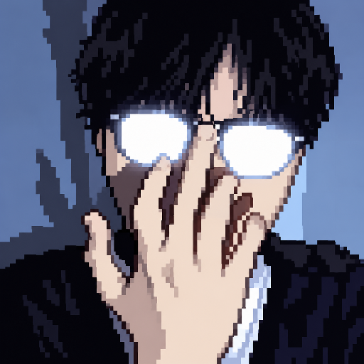

  
    
  
  
  
  
<b>▶ PRESS START TO LOAD PROFILE</b>

  

    <a href="https://chabss-dev.netlify.app">🌐 PORTFOLIO</a> ·
    <a href="https://github.com/chabsseu">💻 GITHUB</a> ·
    <a href="https://liufyx.itch.io/pixelatedd">🕹️ ITCH.IO</a>
  

---

<table>
  <tr>
    <td width="31%" align="center" valign="top" bgcolor="#241e3d">
       
      
        
      
        
      <b>LOC:</b> PHILIPPINES 🇵🇭
    </td>
    <td valign="top" bgcolor="#1f1938">
      <h3>■ PLAYER STATUS</h3>
      

      <b>NAME:</b> Chabss  
      <b>CLASS:</b> Game Dev & Full-Stack Programmer  
      <b>ENGINE:</b> Godot & Unity  
      <b>LANGUAGES:</b> C# · GDScript · PHP · JS  
      <b>TECH STACK:</b> Laravel · Vue · Tailwind · MySQL  
      <b>SPECIAL:</b> Passive Skill — <i>Learning by building</i>
        
      <h3>■ ACTIVE DIALOGUE</h3>
      <table width="100%" bgcolor="#120e24" style="border: 2px solid #483d8b;">
        <tr>
          <td style="padding: 10px; color: #d0cce1; font-family: monospace;">
            "Developing a Philippine-inspired spider-catching RPG, building 2D mechanics in Godot, and sharpening C# systems!"
          </td>
        </tr>
      </table>
    </td>
  </tr>
</table>

## ⚔️ THE ARSENAL (INVENTORY)

<table>
  <tr>
    <td width="50%" valign="top" bgcolor="#1f1938">
      <b>🎮 GAME DEVELOPMENT</b>  
      
      
      
      
    </td>
    <td valign="top" bgcolor="#1f1938">
      <b>💻 WEB DEVELOPMENT</b>  
      
      
      
      
      
    </td>
  </tr>
  <tr>
    <td colspan="2" bgcolor="#1f1938">
      <b>🛠️ SYSTEM TOOLS & ENVIRONMENT</b>  
      
      
      
    </td>
  </tr>
</table>

## 🗺️ QUEST LOG

<table>
  <tr>
    <td bgcolor="#1f1938" width="22%"><b>🕷️ SPIDER RPG</b></td>
    <td bgcolor="#1f1938">Philippine-inspired spider-catching and battling game, rooted in local childhood memories.</td>
    <td bgcolor="#1f1938"></td>
  </tr>
  <tr>
    <td bgcolor="#1f1938"><b>🧙 STAUFFS & MAGIC</b></td>
    <td bgcolor="#1f1938">A 2D action-RPG project made with Godot.</td>
    <td bgcolor="#1f1938"></td>
    <td bgcolor="#1f1938"><a href="https://github.com/chabsseu/Stauffs-and-Magic">View ↗</a></td>
  </tr>
  <tr>
    <td bgcolor="#1f1938"><b>🧩 PIXELATEDD</b></td>
    <td bgcolor="#1f1938">A pixel-style puzzle game playable right in your browser.</td>
    <td bgcolor="#1f1938" colspan="2"><a href="https://liufyx.itch.io/pixelatedd">PLAY ↗</a></td>
  </tr>
  <tr>
    <td bgcolor="#1f1938"><b>▶️ YOUTUBE</b></td>
    <td bgcolor="#1f1938">Devlogs, prototypes, and game dev journeys.</td>
    <td bgcolor="#1f1938" colspan="2"><a href="https://www.youtube.com/@GameDevChabss">WATCH ↗</a></td>
  </tr>
</table>

## 🏆 COMPLETED BUILDS

- **[Pixelatedd](https://liufyx.itch.io/pixelatedd)** — a completed pixel-style puzzle game.
- **[Spider Game](https://github.com/chabsseu/spider-game)** — repository tracking the core architecture for the Philippine-inspired spider-battling RPG.

---

  
    
  <b>✦ GAME OVER? NEVER. JUST RESET. ✦</b>
    
  Thanks for stopping by. May your builds compile and your frame rates stay locked at 60 FPS.

