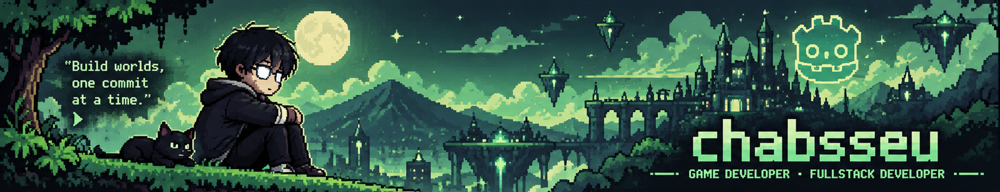

  
    
  
  
  
  

 

<!-- GBA Trainer Card Screen -->

  

 

### 🎒 INVENTORY (THE ARSENAL)

**`[GAME DEV]`** &nbsp;

**`[WEB DEV]`** &nbsp;&nbsp;

**`[SYSTEM]`** &nbsp;&nbsp;&nbsp;

---

### 📜 QUEST LOG

| Quest | Description | Link | Status |
| :--- | :--- | :--- | :--- |
| **🕷️ Spider RPG** | Philippine-inspired spider-catching & battling RPG rooted in local childhood memories. | [Repository](https://github.com/chabsseu/spider-game) | `IN DEVELOPMENT` |
| **🧙 Stauffs & Magic** | 2D action-RPG project built in Godot. | [Repository](https://github.com/chabsseu/Stauffs-and-Magic) | `PAUSE` |
| **🧩 Pixelatedd** | Completed pixel-style puzzle game playable right in your browser. | [Play on itch.io](https://liufyx.itch.io/pixelatedd) | `COMPLETED` |
| **▶️ GameDevChabss** | Devlogs, prototypes, and game development updates. | [YouTube Channel](https://www.youtube.com/@GameDevChabss) | `ONGOING` |

---

  
    
  Thanks for stopping by. May your builds compile and your games ship.

